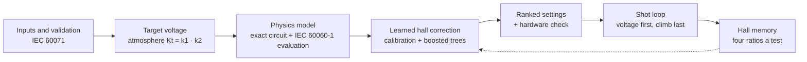

# Impulse Generator Settings for 400 kV Insulator Testing

**Decision support for high-voltage impulse testing: exact IEC circuit physics, a learned hall correction, and a
hardware check, in one offline application.**
Team Slayers, PowerNext-AI (CPRI with MIT Bengaluru), Track 1.

Given an insulator's required withstand level, the tool recommends the **number of stages, the charging voltage per
stage, and the front and tail resistance** for the HAEFELY 508085/E generator, predicts the waveform against the IEC 60060-1
bands, checks the capacitors are not overloaded, and shows how to build each resistor from the units on hand. After a
trial shot it gives the next setting, preferring a voltage change to a climb up the generator.

| | |
|---|---|
| Waveform | Computed by an exact circuit solution and judged by the IEC 60060-1 procedure. Never learned. |
| Learned part | A calibrated-physics plus boosted-tree correction for what a particular hall adds, and a per-hall memory. |
| Checked | 88 Python self-checks, CPRI's kNN reproduced to four decimals (9 of 9), 192 browser checks. |
| Compared | Against CPRI's weighted kNN on their data and on a simulated hall, and against current practice over 120 sessions. |
| Delivered as | `impulse_app.html`, one file, no server. |

## Contents

1. [Problem and scope](#problem-and-scope)
2. [Quick start](#quick-start)
3. [Compliance with CPRI's specification](#compliance-with-cpris-specification)
4. [How it works](#how-it-works)
5. [Repository layout](#repository-layout)
6. [The generator](#the-generator) · [Using it as an operator](#using-it-as-an-operator) · [The offline application](#the-offline-application)
7. [What the AI is, and is not](#what-the-ai-is--and-is-not) · [The comparison CPRI asked for](#the-comparison-cpri-asked-for--against-weighted-knn) · [Results](#results)
8. [Re-running the evidence](#re-running-the-evidence) · [Stated limitations](#stated-limitations) · [Data and confidentiality](#data-and-confidentiality) · [Documents and video](#documents-and-video)

## Problem and scope

Labs choose impulse generator settings by calculation, then fire several reduced-voltage trial shots and adjust the
resistors between them. Each adjustment means someone climbs the generator. CPRI's Track 1 asks for a system that
combines circuit modelling with machine learning to recommend charging voltage, stage utilisation, front resistance and
tail resistance for IEC lightning (1.2/50 µs) and switching (250/2500 µs) impulses, with fewer trial shots.

In scope: lightning and switching impulses on 400 kV-class insulators; positive and negative polarity; the nameplate
machine and its internal resistor units; site atmosphere. Out of scope: transformers (highly inductive), flashover and
test-object failure.

## Quick start

```bash
git clone https://github.com/Shreyaskale7/Impulse_Twin.git && cd Impulse_Twin
pip install -r requirements.txt
python run_all.py                  # every self-check, then the dashboard
```

Open `impulse_app.html` in a browser for the operator application, or use the command line:

```bash
python recommend.py --equipment porcelain_disc_string --um 420 --level 1550 --impulse LI
```

### Setting up `data/`

CPRI's own files are not committed (the folder is ignored on purpose and they are not in the git history). Create
`data/` in the repo root and copy the two files CPRI sent into it, with these names:

```
data/cpri_problem_statement.pdf     # 4 pages; page 4 is the generator nameplate
data/cpri_optimiser.xlsx            # their calculator, dataset and resistor inventory
```

They are needed for `regression.py --cpri`, `tune_cpri.py`, the CPRI-stock check in `recommend.py --self-check`, and
`export_frontend_data.py`. Without them everything else still runs: the physics checks, the benchmark, and the committed
`impulse_app.html` and `impulse_dashboard.html`.

## Compliance with CPRI's specification

| CPRI asked for | Status | Where |
|---|---|---|
| Impulse type, desired crest voltage | Yes | LI / SI toggle; IEC 60071 level, or any kV typed |
| Insulator, divider and stray capacitance | Yes | Measured or inferred; advanced inputs, 500 pF and 150 pF by default |
| Stray inductance | Yes | Advanced input, 1 to 120 µH |
| Available front and tail resistor values | Partly | Nameplate units, ticked per hall, in the browser; any stock in `recommend.py` through `Generator` |
| Stages, charging voltage per stage, front and tail resistance | Yes | With how to build each from stocked units |
| Front, peak and tail time; crest voltage | Yes | Predicted against target |
| % deviation, within or outside limit, ranked alternatives | Yes | Deviation table, tolerance margin, two ranked alternatives |
| Target against predicted waveform | Yes | Idealised double exponential matched to the predicted times |
| Summary dashboard | Yes | Per-request decision summary and the benchmark dashboard |
| Wrong inputs handled | Yes | IEC 60071 level table, range and unit checks |
| Series-parallel resistor combinations | Yes | Pairs of the nameplate units are the stock |
| Positive and negative polarity | Yes | Same setting, reversed charging polarity; treated as symmetric |
| Stage connection (series, parallel, series-parallel) | Physics only | 2p6s to 6p2s with the maximum kV each reaches |

## How it works



1. **Physics computes the waveform.** The generator is reduced to one equivalent stage and solved exactly by
   eigendecomposition; the waveform is evaluated by the IEC procedure (fitted base curve, k-factor, T1, T2, overshoot).
2. **The search is over real stock**: every unit and every series or parallel pair, ranked by margin to the tolerance
   bands, with the charging voltage set analytically and capped at 90 % of the capacitor rating.
3. **The learned correction** calibrates four effective circuit parameters to the hall's shots, then boosted trees learn
   the residual. Overshoot has its own model.
4. **The shot loop** takes the four numbers the evaluator prints and gives the next setting; **hall memory** stores each
   test and moves the next first shot from three same-type tests.
5. **Hardware check**: capacitor voltage and energy per stage and in total, the resistor recipe and unit count, and
   buildability from the nameplate stock and from CPRI's Excel calculator stock.

Ground rules, enforced in code: the IEC evaluation is never replaced by a learned model; designs are
scored on a hidden higher-fidelity hall (`lab.py`), never on the model that produced them; current practice is the baseline;
every approximation is declared where it appears.

## Repository layout

```
.
├── impulse_app.html            offline operator application (the deliverable)
├── impulse_dashboard.html      evidence dashboard
├── circuit.py  waveform.py  atmosphere.py  lab.py      physics, IEC evaluation, atmosphere, hidden test hall
├── design.py  recommend.py  strategies.py              search, operator entry point, shot loop and memory
├── regression.py  tune_cpri.py                         learned correction; comparison with CPRI's kNN
├── benchmark.py  bench_chunk.py                        severity sweep, paired tests
├── export_frontend_data.py  build_app.py  dashboard.py application build
├── stress_test_app.py  run_all.py  compare_generators.py
├── app/        template, precomputed search tables, cross-check vectors
├── results/    benchmark and regression outputs (CSV, JSON)
├── Impulse-Twin-Project-Deck.pptx   the project deck, 17 slides with speaker notes
├── docs/img/   screenshots used by this README
├── video/      scripts that build the video from the real application
├── brag-output/  the two-minute video
├── data/       CPRI's files (local only, not committed)
├── README.md   requirements.txt
```

Module reference:

| File | Does |
|---|---|
| `circuit.py` | Marx generator as a single-stage equivalent circuit, solved exactly. Nameplate, series and parallel columns, stray inductance, divider response. 18 self-checks against Kuffel. |
| `waveform.py` | IEC 60060-1 evaluation: base curve, K-factor test voltage function, T1, T2, overshoot; switching Tp. 12 self-checks. |
| `atmosphere.py` | IEC 60060-1 atmospheric correction, Kt = k1·k2; k1 exact, k2 a declared approximation. 14 self-checks. |
| `lab.py` | A hidden, higher-fidelity impulse hall the design model cannot see into. |
| `design.py` | Exhaustive search over stocked resistors, ranked by margin; optional parallel columns. |
| `recommend.py` | Operator entry point: level in, settings out; IEC 60071 table, wrong-input rejection, polarity, loop inductance, capacitor loading, buildability on both stocks. 35 self-checks. |
| `strategies.py` | Six ways to reach a compliant waveform, from current practice to hall memory. |
| `benchmark.py`, `bench_chunk.py` | The strategies across a severity sweep with an oracle, paired tests, lightning and switching split. |
| `regression.py`, `tune_cpri.py` | The comparison against CPRI's weighted kNN on their data and on the simulated hall; tuning on their protocol. |
| `export_frontend_data.py`, `build_app.py`, `dashboard.py` | Precompute the search tables and learned trees, cross-check the page's JavaScript against Python, write the application and dashboard. |
| `stress_test_app.py` | Drives the finished page in Chromium the way a hostile judge would. |
| `compare_generators.py` | The same request on the nameplate machine and on CPRI's Excel calculator machine. |
| `run_all.py` | Every self-check, then the dashboard. |

## The generator

CPRI's problem statement includes the nameplate of the machine: a **HAEFELY
508085/E**. That is what is modelled.

| | |
|---|---|
| Rating | 2400 kV, 12 stages, 200 kV per stage, minimum 2 active stages |
| Capacitance | 0.125 µF per stage — 2.5 kJ per stage, 30 kJ total |
| Front resistor units per stage | 30 Ω, 465 Ω, 3.7 kΩ |
| Tail resistor units per stage | 520 Ω (lightning), 22 kΩ (switching) |
| Other | charging resistor 135 kΩ, basic load capacitance 545 pF |

The nameplate agrees with the physics. The textbook tail relation
`Rt = T2 / (0.7 · C_stage)` gives 571 Ω for a 50 µs tail; the plate says
520 Ω.

With three front units, **series and parallel pairs of them are part of the
stock**, not an extra. A single 30 Ω reaches the lightning band only on all
12 stages, near its edge; the best-centred front at lower voltages is
30 Ω + 30 Ω in series. Pairs that differ from a single unit by less than its
own ±5% tolerance (30 Ω ∥ 3.7 kΩ = 29.8 Ω) are dropped as the same resistor.

Unconfirmed: how many units of each value a stage takes (pairs assume two),
and why CPRI's Excel calculator uses 15 stages and 3 µF/stage when the
nameplate says 12 and 0.125 µF. CPRI's dataset describes the Excel machine,
so it is used to benchmark against their kNN and not to train the app's
model for the nameplate machine.

## Using it as an operator

The briefing is explicit that the user is a layman: they know the test
object's insulation level, not its capacitance or the hall's stray
inductance. So that is all the tool asks for.

```
python recommend.py --equipment porcelain_disc_string --um 245 --level 950 --impulse LI
```

```
  [RECOMMENDED]
     Stages to erect .......... 6 of 12
     Charging voltage ......... 173.0 kV per stage  (86% of rating)
     Front resistor Rf ........ 60 ohm per stage   (360 ohm total)
        built as: 30 ohm + 30 ohm in series
     Tail resistor Rt ......... 520 ohm per stage   (3120 ohm total)
        built as: single 520 ohm unit
     Expected waveform ........ 1.12 / 50.4 us   overshoot 0.0%
     Tolerance margin ......... 0.22 (below 1.00 = inside every IEC band)
```

At the top of the machine's range there is much less freedom. The
briefing's own example, 1550 kV for a 420 kV-class disc string, needs all 12
stages at 74% charge, and only the single 30 Ω front fits: 0.94 / 52.6 µs,
margin 0.72 — inside the band but close to the 0.84 µs front limit. The
tool says so rather than hiding it.

Wrong inputs are rejected against the IEC 60071 level table, with the valid
options listed — the cross-check the briefing asked for:

```
$ python recommend.py --um 400 --level 1550
  Cannot run this test as requested:
    400 kV is not an IEC 60071 system voltage class.
    Standard classes: 145, 245, 362, 420, 550, 800
```

`400` is the classic slip: 400 kV is the nominal system voltage, and the
IEC class for it is `420`. A level that is standard but unusual for the
declared equipment warns rather than rejects, because labs do test off the
usual combination.

Optionally, if the site's temperature, humidity and pressure (or altitude)
are known, `recommend.py` applies IEC 60060-1's atmospheric correction —
`Kt = k1 × k2` — to the target voltage before searching, exactly as the
standard requires for a test run away from its 20°C / 101.3 kPa / 11 g/m³
reference atmosphere:

```
python recommend.py --temp-c 45 --rh 20 --altitude-m 380
```

```
  Atmospheric correction: Kt=0.914 (k1=0.881 air density, k2=1.038 humidity,
  both APPROXIMATE — see atmosphere.py) -> corrected target 1417.4 kV
```

k1 (air density) is the standard's own exact formula. **k2 (humidity) is
not** — IEC 60060-1 defines it as a graph, not an equation, and that curve
was not available to digitize precisely; a documented linear approximation
is used instead, declared wherever it appears (`atmosphere.py`). Leaving
site conditions unset gives Kt=1 — no correction, today's behaviour,
unchanged.

The offline app (`impulse_app.html`) does the same, and adds the **hybrid
hall correction** — CPRI's own pipeline (physics → learned residual
correction → compliance check → recommendation) with our model in place of
their kNN. It is `regression.py`'s hybrid run unchanged: the
physics-calibration half precomputed in Python, the boosted trees exported
from the fitted model and executed in the browser, and the page's JavaScript
checked against the Python predictions before every build. Physics-alone
values are shown beside every corrected one, and the switch turns the
correction off.

After a shot, the app's **shot loop** takes the four numbers the IEC
evaluator prints — T1 or Tp, T2, test voltage, overshoot — and gives the next
setting: the same resistors at a new charging voltage when only the crest
missed, otherwise the setting needing the fewest resistor changes among those
predicted comfortably in band. It is `strategies.app_loop` rule for rule,
benchmarked below, searching the whole resistor stock. **The correction shipped is learned from a simulated hall**:
the app says so, and it has to be retrained on CPRI's own trial shots before
anyone relies on it.

Three more things the app does, each checked against the Python it mirrors
before the page is written:

- **It remembers the hall.** Every finished shot loop is stored in the
  browser as one test: the median measured-to-textbook ratio of the four
  evaluator readings. Once three tests of the same impulse type exist, the
  next first shot is designed with that remembered correction — the
  benchmarked `strategies.app_memory` rule, which beats current practice
  below. It stays on the machine; "Load demo memory" fills it with ten tests
  from the simulated hall so it can be seen working.
- **It predicts overshoot, and warns.** The hall rings where the textbook
  says it will not (8.3% measured where physics said 0.2%). A fourth learned
  correction predicts overshoot; a setting predicted at 5% or more — half the
  IEC limit — carries a ringing-risk warning, and one predicted over 10% is
  ranked as outside the band.
- **It shows its evidence.** Under every option, the five most similar shots
  in the log and what CPRI's kind of kNN would predict from them, next to the
  number the app is using — the explainability CPRI chose kNN for.

## The offline application


`impulse_app.html` is one file, no server. Its inputs follow CPRI's own list:

| Input | How |
|---|---|
| Impulse type, polarity | Lightning / switching; positive / negative |
| Crest voltage | IEC 60071 level for the system class, or any kV typed |
| Equipment, system class | Cross-checks the level; supplies the capacitance range |
| Insulator capacitance | Measured, or inferred from the equipment type |
| Divider, stray capacitance | Advanced inputs, 500 pF and 150 pF by default |
| Lead / loop inductance | Advanced input, 1 to 120 µH; runs the physics at that value |
| Resistor units available | Tick the nameplate units the hall has, and units per stage |
| Site atmosphere | Temperature, humidity, altitude or pressure |

Every result carries:

- a **decision summary** (IEC shape, crest, capacitor loading, buildable,
  ringing risk, alternatives);
- the **setting** with predicted front or peak time, tail time, overshoot and
  tolerance margin, and how to build each resistor;
- a **deviation table** (predicted against target, signed %, band, within or
  outside the limit) and a **target against predicted waveform** plot (an
  idealised double exponential matched to the predicted times; overshoot is
  reported as a number, not drawn);
- a **hardware check**: charge per stage against the 200 kV rating and the
  90 % operating limit, energy per stage against 2.5 kJ and total against
  30 kJ, the unit count, and whether each value can be built from the
  nameplate stock and from CPRI's Excel calculator stock;
- the **series-parallel stage connection** options (2p6s, 3p4s, 4p3s, 6p2s,
  physics only, with the maximum kV each can reach);
- the five most similar logged shots beside the CPRI-style kNN prediction.

A **Physics** tab lists every equation used. Declared limits, also stated in
the app: polarity is treated as symmetric (the circuit is linear; not
benchmarked); divider, stray and inductance entries are exact for the physics
and approximate for the learned correction, which is switched off when an
inductance is entered; resistor availability restricts the search to the
nameplate units (other stocks run in `recommend.py` through `Generator`);
the shot loop and hall memory cover all-in-series only.


The Physics tab lists every equation the application uses:


## What the AI is — and is not

If a real generator behaved exactly like the textbook circuit, no AI would be
needed: you would solve the equations for Rf and Rt. So the waveform itself is
computed by physics, and IEC evaluation is left exactly as the standard
defines it, overshoot limit included. (In the textbook model no stocked
setting has an in-band front and tail yet fails on overshoot alone. In the
simulated halls it happens, because their extra lead inductance rings the
circuit: the illustrative session in the app is one — 9 stages, 30 Ω, a
1.23 / 45.5 µs waveform at 10.9% overshoot.) AI goes only where the
equations cannot reach:

- **Physics calibration.** After each shot, fit the circuit's hidden
  parameters — loop inductance, load capacitance, divider response,
  efficiency — to the measured waveform, then redesign.
- **Lab memory.** Calibration, plus a first shot that already uses what the
  hall has learned from previous sessions: its parasitics and each insulator
  type's capacitance bias.
- **Black-box Bayesian optimisation.** A Gaussian process over the stocked
  resistors that knows nothing about circuits. Included to test whether AI
  *without* physics helps.
- **The app shot loop, and the app with hall memory.** What the offline app
  can do without a circuit solver: work from the four evaluator readings,
  and remember them across tests.

All of them are measured against **current practice**: a textbook first guess,
then the rule every lab uses — scale Rf by the front-time error, Rt by the
tail error, snap to stock.

## The comparison CPRI asked for — against weighted kNN

Dr. Sheshu Kumar (CPRI High Voltage Division) built the reference solution:
circuit equations, then a **weighted k-nearest-neighbours residual
regression** to correct the gap between theoretical and measured waveforms.
Teams are asked to make it more accurate, judged on regression metrics. We
answer on two datasets, because they say different things.

### On CPRI's own dataset

CPRI's Excel ships a 2000-row synthetic dataset and their kNN (k = 7). We
reimplemented it from their sheet formulas and, trained on their Train split
and scored on Validation + Hidden Test, it **reproduces all nine of their
reported metrics to four decimals**. Everything below is compared against
that exact reproduction.

| Model | Front / peak time | Tail time | Crest voltage |
|---|---|---|---|
| Physics only | 0.727% | 1.124% | 0.665% |
| **CPRI weighted kNN** | 0.609% | 1.056% | 0.333% |
| **Ridge regression** | **0.570%** | **1.000%** | 0.319% |
| Gradient boosting | 0.596% | 1.015% | **0.314%** |
| Random forest | 0.602% | 1.021% | 0.326% |
| Neural network (MLP 64-64) | 0.574% | 0.999% | 0.315% |

Paired against their kNN, row by row: Ridge is better on all three targets
(p = 0.035 / 0.038 / 0.037); the neural network on tail and crest (p = 0.036
/ 0.0085) but not front; gradient boosting on crest only (p = 0.0095). The
network lands level with Ridge — a bigger model cannot learn noise.

What that honestly means:

- **We beat CPRI's kNN on their data, but narrowly** — 4–6% relative. Ridge's
  p-values would not survive a correction across the fifteen comparisons in
  the table, so this is a lead, not a proof.
- **The ceiling is the data, not the model.** The best model explains 40% of
  the front-time residual, 29% of tail and 79% of crest; the rest behaves as
  noise. No algorithm can recover what was never structured.
- **The reported R² of 0.9999 cannot separate models.** It is measured on the
  observed waveform times, and physics alone already gets 0.73% front error.
  The share of the *residual* explained is the metric that discriminates.
- **Their dataset has settings that cannot be built.** Every switching-impulse
  row uses front 9.4–21.8 kΩ and tail about 1.2 kΩ per stage; neither their
  own Excel inventory nor the nameplate units can make those. Asked of CPRI.
- **Real measured trial shots are what would move this.** CPRI's own model
  card lists laboratory validation as pending actual data.

### On our simulated hall

A dataset from one hidden hall (338 shots, severity 3), sampled the way a
real shot log would be — only settings an engineer would consider near the
target. Here the residual has physical structure, so the gap is large.

Random 3-fold cross-validation:

| Model | Front time error | Tail time error | Peak error | Pass/fail correct |
|---|---|---|---|---|
| Textbook only | 8.57% | 5.28% | 2.96% | 73.7% |
| **Weighted kNN (CPRI)** | 5.38% | 2.95% | 1.91% | 87.0% |
| Gradient boosting | 1.20% | 0.40% | 0.21% | 97.6% |
| Neural network (MLP 64-64) | 2.16% | 0.88% | 0.53% | 96.1% |
| **Hybrid: physics + boosting (ours)** | **0.80%** | **0.30%** | **0.15%** | **98.2%** |
| Hybrid: physics + neural network | 1.05% | 0.36% | 0.21% | 97.3% |

Extrapolation — train on the smaller 70% of insulators, test on the larger
30%:

| Model | Front time error | Tail time error | Pass/fail correct |
|---|---|---|---|
| Textbook only | 8.91% | 5.72% | 70.6% |
| **Weighted kNN (CPRI)** | 7.04% | 3.75% | 83.3% |
| Gradient boosting | 1.73% | 0.82% | 95.1% |
| Neural network (MLP 64-64) | 6.51% | 2.55% | 89.2% |
| **Hybrid: physics + boosting (ours)** | **1.16%** | **0.34%** | 98.0% |
| Hybrid: physics + neural network | 1.83% | 0.73% | **99.0%** |

How many past shots each method needs (front-time error · pass/fail):

| Shots | Weighted kNN | Gradient boosting | Hybrid |
|---|---|---|---|
| 20 | 7.55% · 83% | 3.26% · 92% | **1.95% · 94%** |
| 80 | 5.82% · 88% | 1.63% · 96% | **1.01% · 98%** |
| 250 | 5.31% · 90% | 1.18% · 96% | **0.78% · 98%** |

- **The hybrid is 6.7× more accurate than kNN on front time**, and 6.1× on
  insulators outside the training range.
- It has the lowest front-time error at every history length. Pass/fail is
  not a clean sweep: at 20 shots physics calibration alone scores 95% against
  the hybrid's 94%, and at 40 shots boosting scores 99% against 96%.
- **Neural networks do not beat boosting, and physics is what lets a learned
  model extrapolate.** A network alone collapses to 6.51% front error on
  larger insulators — barely better than kNN — while physics + network holds
  at 1.83%. Across five seeds the network alone scores 3.03 ± 0.93% (the table
  shows seed 0, a flattering draw); with physics 1.05 ± 0.05, 18× more
  stable. With ~340 shots and 13 inputs, trees win, as they usually do on
  small tables.
- **Accuracy above 95% on synthetic data is treated as suspect.** The
  simulated hall is deterministic apart from small noise, so its quirks —
  including each stocked resistor's fixed tolerance — are learnable. The 6×
  here is not evidence about CPRI's data; the section above is.

**Overshoot**, on the 221 lightning shots (error in percentage points; the
ringing flag is whether overshoot of 5% or more is called correctly — true
of 54% of these shots):

| Model | Random CV error | Ringing flag | Larger insulators error | Ringing flag |
|---|---|---|---|---|
| Textbook only | 6.28 | 46% | 6.80 | 41% |
| **Weighted kNN (CPRI)** | 0.37 | 99.5% | 1.16 | 90% |
| Gradient boosting | 0.19 | 100% | 0.37 | 94% |
| Physics calibration | 1.16 | 99.6% | 1.59 | 91% |
| **Hybrid: physics + boosting (ours)** | **0.16** | **100%** | **0.19** | **100%** |

The textbook misses ringing almost entirely (at most 1.2% predicted where the
hall reached 15.2%). kNN learns it well inside its data and loses it outside;
the hybrid holds: kNN's error is 2.3× the hybrid's under cross-validation
and 6.1× on larger insulators. Same caveat as
above: a simulated hall's ringing is learnable in a way a real hall's may not
be.

Two mistakes found and fixed on the way: the first physics calibration
omitted the divider response time, and fitted two parameters that are
indistinguishable on small insulators. Together they gave a 10%
extrapolation error — worse than kNN. A misspecified physics model does not
fail gracefully; it confidently extrapolates the wrong thing.

## Results

120 sessions, 30 per severity, 12 halls; 2 excluded because no stocked
setting complies. Severity 1 is a well-characterised hall; 4 is long leads,
unknown strays, a slow divider and poor capacitance estimates. Unsolved
sessions are counted at the 10-shot budget, and every strategy gets its own
measurement-noise stream, so changing one cannot move another's result.

| Severity | Current practice | Black-box BO | Physics calibration | Lab memory | App shot loop | App with hall memory |
|---|---|---|---|---|---|---|
| | first % · shots | first % · shots | first % · shots | first % · shots | first % · shots | first % · shots |
| 1 | 100 · 1.00 | 100 · 1.00 | 100 · 1.00 | 90 · 1.10 | 100 · 1.00 | 100 · 1.00 |
| 2 | 67 · 2.67 | 63 · 3.70 | 63 · 1.37 | 77 · 1.23 | 70 · 1.30 | **97 · 1.03** |
| 3 | 40 · 2.93 | 43 · 5.93 | 40 · 2.40 | **70 · 1.30** | 37 · 2.50 | 63 · 1.67 |
| 4 | 28 · 3.52 | 28 · 7.10 | 31 · 2.24 | **62 · 1.66** | 31 · 2.24 | 59 · 1.97 |

Solved within the 10-shot budget at severities 3 and 4: current practice
83% and 79%, black-box BO 60% and 59%, physics calibration and the app loop
90% and 93%, lab memory **100% and 97%**, the app with hall memory 97% and
93%.

**Climbs up the generator** (resistor changes) per session at severities 3
and 4: current practice 1.63 and 2.10, lab memory **0.03 and 0.38**, the app
with hall memory 0.37 and 0.48.

Paired against current practice on the poorly characterised halls
(severities 3–4, 59 sessions). We run twenty-six such tests, so a result has
to beat p = 0.0019 to survive a Bonferroni correction:

| Strategy | Measure | Better | Worse | Same | Wilcoxon p | Verdict |
|---|---|---|---|---|---|---|
| **Lab memory** | shots | 30 | 4 | 25 | **<0.0001** | **better** |
| **Lab memory** | climbs | 19 | 1 | 39 | **0.0007** | **better** |
| **App with hall memory** | shots | 25 | 4 | 30 | **0.0001** | **better** |
| **App with hall memory** | climbs | 17 | 1 | 41 | **0.0004** | **better** |
| **Physics calibration** | climbs | 12 | 0 | 47 | **0.0019** | **better**, at the edge (0.00189) |
| Physics calibration | shots | 8 | 1 | 50 | 0.010 | better, not after correction |
| App shot loop | climbs | 11 | 0 | 48 | 0.0029 | better, just short of correction |
| App shot loop | shots | 7 | 2 | 50 | 0.019 | better, not after correction |
| Black-box BO | shots | 1 | 27 | 31 | <0.0001 | **worse** |
| Black-box BO | climbs | 5 | 26 | 28 | 0.0002 | **worse** |

And the memory's own worth: the app with hall memory against the app loop
without it, 21 better, 3 worse (p = 0.0003); against full physics calibration,
19 better, 4 worse (p = 0.0016). Both survive the correction.

### Lightning and switching, separately

The benchmark draws the impulse type per session, so this splits 118
sessions into 67 lightning and 51 switching. At severities 3–4 (27 lightning,
32 switching sessions), paired against current practice on shots:

| Strategy | Lightning: better / worse, p | Switching: better / worse, p |
|---|---|---|
| Lab memory | 13 / 4, p = 0.038 | 17 / 0, p = 0.0002 |
| App with hall memory | 11 / 2, p = 0.012 | 14 / 2, p = 0.0022 |
| Physics calibration | 0 / 0 — identical in all 27 | 8 / 1, p = 0.010 |
| App shot loop | 0 / 0 — identical in all 27 | 7 / 2, p = 0.019 |

Exploratory — outside the correction family, and each half is small. But
the pattern is clear. **On lightning, current practice either complies within
two shots or not within ten** (9 of 67 sessions), and every strategy that
keeps the first shot's stage count fails the same sessions. At that stage
count the stock has no front resistor between the one that rings past the
10% overshoot limit and the one that makes the front too slow. Only a first
shot informed by the hall's history picks a different stage count. On
switching, where there is no overshoot limit, every physics-based follow-up
helps.

### What that means, plainly

1. **In a well-characterised hall, current practice already succeeds on the
   first shot** — 100% at severity 1. IEC's windows are wide, so a design
   aimed at the centre absorbs most mismatch. We say so first.
2. **In a poorly characterised hall it does not**: 28–40% first shot. The
   nameplate stock is coarse — 13 front values, 3 tail values a factor of 2
   apart — so the scale-and-snap rule often steps past the few compliant
   settings. That is the problem worth solving.
3. **Lab memory solves it — on both of CPRI's measures.** It needs fewer
   shots than current practice in 30 of the 59 hard sessions and more in 4
   (p < 0.0001), and fewer climbs up the generator in 19 and more in 1
   (p = 0.0007). It also beats physics calibration alone (25 vs 4,
   p = 0.0004).
4. **Most failed first shots need a different charging voltage, not a
   climb.** In about two thirds of the missed first shots the waveform shape
   was already inside every IEC band and only the test voltage was off.
   Calibration and the app loop fix those at the control desk; current
   practice swaps a resistor whenever a time error exceeds 0.8 of tolerance,
   even inside the band, and so climbs where it need not.
5. **The app's shot loop does almost everything full calibration does, from
   four numbers.** It sees only what the evaluator prints — T1 or Tp, T2,
   test voltage, overshoot — with no waveform fit, and it starts from current
   practice's own first shot. It matches physics calibration in 53 of 59 hard
   sessions. That is what runs in the offline app.
6. **AI without physics is worse than a technician.** Black-box Bayesian
   optimisation needs more shots in 27 of 59 hard sessions and more climbs
   in 26. This held on every generator model we built.
7. **Where the climbs used to come from.** A failed shot banned its resistor
   combination even when the shape had passed and only the crest missed.
   Now a shape-passing shot is re-fired at a corrected voltage, and otherwise
   the candidate needing the fewest resistor changes wins among those
   predicted comfortably in band. Its one threshold (0.8 of tolerance, the
   technician's own trigger) was fixed before the benchmark ran.
8. **The browser can carry the memory.** With only the four evaluator
   readings stored per test, the app with hall memory beats current practice
   on shots (p = 0.0001) and climbs (p = 0.0004), and beats the same app
   without memory (p = 0.0003). Lab memory, which fits the recorded
   waveforms, is still better at severities 3–4 (70 / 62% first shot against
   63 / 59%).
9. **Lab memory still costs a little on easy halls**: 90% first shot at
   severity 1 against 100%. Paired it is not significant (p = 0.11), but it
   is visible, and it is an open defect. The app's memory does not show it
   (100% at severity 1).

Which severity a real CPRI hall sits at is the question we cannot answer
without real shot records.

## Re-running the evidence

| Check | Count |
|---|---|
| `circuit.py` / `waveform.py` / `atmosphere.py` / `recommend.py` self-checks | 18 / 12 / 14 / 35 |
| `regression.py --cpri`: CPRI's kNN reproduced from their sheet | 9 of 9 |
| `build_app.py`: page JavaScript against Python; the build stops on a mismatch | hybrid 60 vectors, overshoot 30, similar shots 24, memory 20 + 20 |
| `stress_test_app.py`: the finished page in Chromium | 192 checks |

```
python regression.py --cpri                  # CPRI's dataset: seconds
python regression.py --n 360                 # simulator dataset + evaluation
python regression.py --reuse --curve         # learning curve
python regression.py --reuse --overshoot     # overshoot prediction (P8)
python bench_chunk.py --parallel             # benchmark, one process per hall
python bench_chunk.py --parallel --halls 5   # 20 halls, same wall clock
```

Benchmark halls are independent, so `--parallel` costs about what one hall
costs. Parts land in `bench_parts/`; a failed hall re-runs alone with
`--part <severity> <hall>`, then `--merge` rebuilds results and summary.
`export_frontend_data.py` then `build_app.py` rebuild the offline app
(`build_app.py --reuse-session` in about 20 seconds when only the results or
the page changed).

## Stated limitations

- The hall is a simulator. Results measure robustness to a specified class of
  mismatch, not performance on a real generator.
- **Unconfirmed hardware**: units of each resistor per stage (pairs assume
  two), loop inductance (textbook values), and what the nameplate's "1 p12 s;
  p s" connection means. It is read as whole-bank parallel columns, physics
  only; the learned correction, shot loop and memory cover all-in-series.
- **Polarity** is treated as symmetric; real gaps and dividers can differ.
- **Resistor values** beyond the nameplate units run in the Python engine,
  not in the browser.
- **CPRI's dataset** describes a 3 µF, 15-stage machine and is a benchmark,
  not training data for the nameplate machine.
- **Severity couples two things**: how well the hall is characterised, and how
  large the setup is (effective load capacitance scales up to 5.5×). These
  should be separated.
- 30 sessions per severity. Enough for the paired tests above, not for fine
  distinctions.
- The front-time check under a 1 MHz oscillation passes on a loose band and
  should be validated against IEC 61083-2 reference waveforms.
- The app's hall memory lives in one browser's storage; it is not shared
  between machines and a private window starts empty.
- Overshoot limit and the switching-impulse definition follow IEC 60060-1:2010.
  The 2025 edition redefines the standard switching impulse as 170/2500 µs.
  Confirm which edition CPRI evaluates against.
- IEC 60071 test levels for the 420 kV class (1300/1425/1550 kV LI,
  950/1050 kV SI) should be confirmed against the edition in use.
- Insulator flashover and test-object failure are not modelled.

## Data and confidentiality

CPRI's problem statement and Excel workbook are the team's inputs, are listed in `.gitignore`, and have never been in
the repository history. The committed `results/` and `app/` files are derived outputs. The learned model is trained on a
simulated hall, not on CPRI's data, because CPRI's dataset describes a different machine (3 µF per stage, 15 stages).
No open-source licence has been applied.

## Documents and video

| File | What |
|---|---|
| `Impulse-Twin-Project-Deck.pptx` | The whole project in 17 slides with speaker notes |
| `brag-output/brag.mp4` | Two-minute video: what we did and how it complies with CPRI's list |
| `video/` | The scripts that build the video from the real application (`render.py`, `audio.py`, `finish.py`; needs `video/requirements.txt`) |
